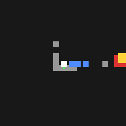

# bot-party-dreamer

[DreamerV3](https://arxiv.org/abs/2301.04104) learns to play **[Bot Party](https://github.com/AnCarsenat/bot-party)**
(Party mode) as P1 against 3 built-in bots. Bot Party is a Godot 4 party game written by my son;
this repo is the dad's side project to "cheat" at it with reinforcement learning.



*What Dreamer perceives in a race, drawn from its 65 inputs: P1 white (center) and its velocity
(green), walls and floors from 16 rays (grey), traps (red), the other robots (blue), the flag
(yellow, on the border when far).*

## How it works

```
 Python                                             Godot (Bot Party + godot/ from this repo)
 ┌──────────────────────────────┐   TCP :11008   ┌────────────────────────────────────────┐
 │ train.py → dreamer.main()    │◄──────────────►│ RlSync (godot_rl_agents Sync)          │
 │  └ botparty_dreamer/env.py   │  obs, reward,  │  └ DreamerController: presses P1's keys│
 │     └ godot_rl GodotEnv      │  done / action │ HelperBot: picks & places for P1       │
 └──────────────────────────────┘                │ PartyBot ×3: the opponents             │
                                                 └────────────────────────────────────────┘
```

- **One episode = one race** of P1, from "Go!" to the flag, a trap, a pit or the 40 s clock.
  Picking and placing items, the countdown and the scores run on their own between episodes.
- **Observation:** 65 floats (to the flag, velocity, 16 rays, 6 nearest traps, 3 nearest robots).
- **Actions:** 6 = {none, left, right} × {jump, no jump}, held for 4 frames.
- **Reward:** +0.3 per cell closer to the flag than ever before in the race (on the bots' own
  distance map), +10 at the flag, +5 if first, -5 for a trap or pit, -1 when the clock runs out,
  a small time penalty. Trying beats waiting, waiting beats dying
  ([why](doc/implementation_log.md#step-8--reward-adjustment-then-resume-the-short-run-2026-10-24-2223)).
- **Recorded races** can be re-scored after a reward change: `tools/relabel_rewards.py <logdir>`.
- [dreamerv3-torch](https://github.com/NM512/dreamerv3-torch) is used **unmodified**; `train.py`
  plugs in the env and works around a few issues (CPU device, Windows video files, config loading).

The full story, step by step with results and every problem met:
[doc/implementation_log.md](doc/implementation_log.md). The initial plan: [doc/dreamer3_steps.md](doc/dreamer3_steps.md).

## Setup

Clone the four repos side by side (the scripts look for siblings; override with `BOT_PARTY`,
`DREAMER`):

```powershell
git clone https://github.com/AnCarsenat/bot-party
git clone https://github.com/NM512/dreamerv3-torch
git clone https://github.com/edbeeching/godot_rl_agents
git clone https://github.com/namsor/bot-party-dreamer
cd bot-party-dreamer
```

1. **Godot 4.7** — point `GODOT` to the binary (on Windows the `*_console.exe`), or put `godot` on the PATH:
   ```powershell
   setx GODOT "C:\Tools\Godot\Godot_v4.7.2-stable_win64_console.exe"
   ```
2. **Game side** — copies `godot/` into the game on a branch `dreamer` (its `main` stays clean),
   adds the `--rl` command-line option, then registers the new scripts:
   ```powershell
   python tools/install_godot.py ../bot-party
   & $env:GODOT --headless --path ../bot-party --import
   ```
3. **Python 3.13** (CPU is enough; no CUDA needed):
   ```powershell
   py -3.13 -m venv .venv
   .venv\Scripts\pip install torch --index-url https://download.pytorch.org/whl/cpu
   .venv\Scripts\pip install -r requirements.txt
   .venv\Scripts\pip install --no-deps -e ../godot_rl_agents
   ```

Training runs the game with its own `APPDATA` (`runs/appdata/<port>`): your real Bot Party
saves and settings are never touched.

## Use

```powershell
.venv\Scripts\python tools/smoke_env.py --episodes 3 --window --speedup 1   # random player, in a window
.venv\Scripts\python train.py --configs botparty smoke                      # end-to-end check (~45 min on CPU)
.venv\Scripts\python train.py --configs botparty short                      # ~2-3 h, a game window every 10 min
.venv\Scripts\python train.py --configs botparty                           # long run
.venv\Scripts\tensorboard --logdir logdir                                  # http://localhost:6006
.venv\Scripts\python watch.py --configs botparty short --logdir logdir/short --speedup 1   # watch a checkpoint
```

- Any config key can be overridden: `--bot_skill hard`, `--arena`-style tasks `--task botparty_pillar`,
  `--eval_minutes 5`, `--speedup 4`.
- A run resumes from `<logdir>/latest.pt` and `<logdir>/train_eps/` when started again with the same `--logdir`.
- Watching: evaluation races open a game window (`eval_window`, `eval_speedup`); TensorBoard shows
  `train_return`, `eval_return`, `log_train_first / finished / eliminated` and the minimap videos
  (also saved as `logdir/<run>/videos/*.gif`).

## Layout

```
botparty_dreamer/game.py   start Godot in --rl mode (isolated APPDATA)
botparty_dreamer/env.py    Dreamer env: state, actions, per-race stats, eval minimap
configs/botparty.yaml      presets botparty / smoke / short (on top of dreamerv3-torch defaults)
train.py                   dreamer.main() with our make_env + fixes, eval every N minutes
watch.py                   load latest.pt and race in a window
godot/rl/                  RlTrainer, RlSync, DreamerController, HelperBot (GDScript)
godot/addons/              subset of godot_rl_agents_plugin (MIT, see its LICENSE)
godot/command_line.patch   the --rl option for core/command_line.gd
tools/                     install_godot.py, smoke_env.py, probe_party.gd
doc/                       plan, implementation log, README image
```

## Credits

- [Bot Party](https://github.com/AnCarsenat/bot-party) by AnCarsenat — the game, its bots and
  their distance map, reused by the Dreamer controller.
- [dreamerv3-torch](https://github.com/NM512/dreamerv3-torch) (MIT) by NM512.
- [godot_rl_agents](https://github.com/edbeeching/godot_rl_agents) and its
  [plugin](https://github.com/edbeeching/godot_rl_agents_plugin) (MIT) by Edward Beeching et al.

This repo: MIT (see [LICENSE](LICENSE)).
